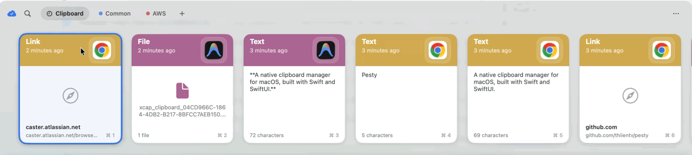

<div align="center">


# Pesty

**A native clipboard manager for macOS, built with Swift and SwiftUI.**

[](https://github.com/thiientv/pesty/releases/latest)
[](LICENSE)




</div>

Pesty keeps a searchable history of copied content in a full-width strip. Press the global shortcut, select a clip, and paste it back into the previously active app.

## Features

- Native menu-bar app with a slide-up clipboard strip.
- Text, rich text, links, images, files, and colors.
- Instant search and keyboard navigation.
- Named pinboards for organizing reusable clips.
- Rename pinboards and assign preset or custom colors to every card in the group.
- Copy or move clips between pinboards from the context menu or by dragging them onto a pinboard tab.
- Pin important clips to the beginning of each pinboard with a visible pin badge.
- Drag clips to reorder them within their pinned or unpinned section.
- Horizontal mouse-wheel scrolling without holding Shift.
- Multi-selection, bulk deletion, editing, preview, sharing, and drag-and-drop.
- Optional iCloud sync across Macs.
- Per-app privacy exclusions and concealed clipboard-item filtering.
- Configurable global shortcut, quick-paste modifiers, retention, and launch at login.
- Universal builds for Apple Silicon and Intel with no third-party dependencies.

## Install

Download the latest DMG from [GitHub Releases](https://github.com/thiientv/pesty/releases/latest), open it, and drag **Pesty** to **Applications**.

On first direct paste, macOS requests Accessibility access. Grant it in **System Settings → Privacy & Security → Accessibility**.

## Usage

The default shortcut is `⌘⇧V`.

### Pinboards

- Click `+` in the top bar to create a pinboard.
- Right-click a pinboard to rename it, change its color, or delete it.
- Right-click a clip and use **Copy to Pinboard** or **Move to Pinboard**.
- Drag a clip onto another pinboard tab to move it there.
- Inside a pinboard, right-click a clip and choose **Pin to Top** or **Unpin from Top**.
- Drag clips left or right to reorder them inside a pinboard. Pinned clips remain before unpinned clips.
- Use a trackpad horizontal gesture or a regular vertical mouse wheel to move through long clip strips.

### Keyboard shortcuts

| Key | Action |
| --- | --- |
| `⌘⇧V` | Show or hide the strip; configurable in Settings |
| `⌘⇧S` | Open Settings while the strip is visible |
| `⌘⇧P` | Pause or resume clipboard monitoring |
| `←` `→` `↑` `↓` | Move the selection |
| `return` | Paste the selected clip |
| `⌘1`–`⌘9` | Quick-paste a visible clip; modifiers are configurable |
| `⌫` or `⌘⌫` | Delete the selected clip or clips |
| Type | Search the current history or pinboard |
| `esc` | Clear selection/search, then close the strip |

## Build from Source

Requirements:

- macOS 14 or later.
- Swift 6 toolchain. Release CI currently uses Xcode 26.3.

```bash
git clone https://github.com/thiientv/pesty.git
cd pesty

swift build
swift run
```

For UI development with generated sample clips:

```bash
swift run Pesty --demo
```

To assemble a universal, ad-hoc-signed app for local use:

```bash
VERSION=1.0.0 BUILD=1 ./scripts/build_app.sh
open packaging/Pesty.app
```

> [!WARNING]
> Development and release builds are not data-isolated. They can read and update the same `Application Support/Pesty` or iCloud Drive `Pesty` store. Quit the installed release before running a development build, and back up the store before testing deletion, retention, demo data, or sync changes.

## Release

The **Release** GitHub Actions workflow is started manually from **Actions → Release → Run workflow**. It builds a universal app, imports the Developer ID certificate, signs and notarizes the app and DMG, computes its SHA-256 checksum, and creates the GitHub release.

Configure these repository secrets before running the workflow:

```text
MACOS_CERT_P12_BASE64
MACOS_CERT_PASSWORD
KEYCHAIN_PASSWORD
ASC_KEY_P8_BASE64
ASC_KEY_ID
ASC_ISSUER_ID
SIGN_IDENTITY
```

A local signed and notarized release uses the same build scripts:

```bash
VERSION=1.0.0 BUILD=1 \
SIGN_IDENTITY="Developer ID Application: Your Name (TEAMID)" \
ASC_KEY="$HOME/.appstoreconnect/private_keys/AuthKey_XXXX.p8" \
ASC_KEY_ID="XXXX" \
ASC_ISSUER="<issuer-uuid>" \
./scripts/release_build.sh
```

The output is written to `packaging/Pesty-<version>.dmg`.

The Mac App Store package has a separate sandboxed build:

```bash
VERSION=1.0.0 BUILD=1 ./scripts/build_mas.sh
```

It requires an Apple Distribution certificate, installer certificate, provisioning profile, App Store Connect app, and matching iCloud container.

## Project Structure

```text
Sources/Pesty/
  Main.swift            Application entry point
  AppController.swift   App lifecycle, menu bar, hotkeys, and paste flow
  Models/               Clip and pinboard models
  Store/                Clipboard history, pinboards, and persistence
  Monitor/              Clipboard capture and paste service
  Hotkey/               Carbon global hotkey registration
  UI/                   Strip, cards, pinboard tabs, preview, and editor
  Settings/             Preferences and shortcut recorder
  Sync/                 CloudKit schema and synchronization
  Util/                 Shared AppKit and SwiftUI utilities
scripts/                Local, release, notarization, icon, and MAS builds
packaging/              Info.plist, entitlements, and generated artifacts
.github/workflows/      CI and manual release automation
```

## Contributing

See [CONTRIBUTING.md](CONTRIBUTING.md). Keep changes focused, preserve compatibility with existing clipboard stores, and run `swift build` before opening a pull request.

## License

[MIT](LICENSE) © 2026.

## Disclaimer

Pesty is an independent project and is not affiliated with, endorsed by, or connected to Paste or its makers. All trademarks belong to their respective owners.
